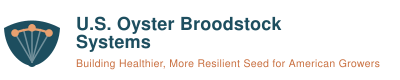

This page collects the shared working resources for investigators, staff, and trainees on the project. Most links require that you already have access; contact the [project director](contact.qmd) if you need to be added.

## Shared resources

::: {.resource-grid}

::: {.resource-card}
### [GitHub organization](https://github.com/oyster-broodstock)
Code, analysis repositories, data schemas, and the source for this site. Repositories are public by default; ask to be added to the organization so you can push.
:::

::: {.resource-card}
### [Google Drive](https://drive.google.com/drive/folders/1O_YQRvay1TY9AHXgQPHQuV3bQebozSIh?usp=share_link)
Shared project folder: documents, meeting notes, reporting materials, and protocol drafts.
:::

::: {.resource-card}
### [Project calendar](https://calendar.google.com/calendar/u/0/embed?src=c_2d268a87297268b5d53e0f2a0184f50f09aada89d9248789d612eeaaa0ef2846@group.calendar.google.com&ctz=America/Los_Angeles)
Quarterly all-investigator teleconferences, semi-annual Stakeholder Advisory Board meetings, workshops, and the annual in-person meeting.
:::

::: {.resource-card}
### [Slack](https://oyster-cap.slack.com/)
Day-to-day coordination across the project teams in the `oyster-cap` workspace.
:::

::: {.resource-card}
### [Logo & brand files](#project-logo)
Logo files in SVG and PNG, the project color palette, and the rules for using them on slides, posters, and reports.
:::

:::

## Calendar

The calendar below is shared with project personnel only. If you see a Google sign-in prompt, sign in with the account that was granted access, or open it [in Google Calendar](https://calendar.google.com/calendar/u/0/embed?src=c_2d268a87297268b5d53e0f2a0184f50f09aada89d9248789d612eeaaa0ef2846@group.calendar.google.com&ctz=America/Los_Angeles).

```{=html}
<div class="calendar-embed">
<iframe
  src="https://calendar.google.com/calendar/embed?src=c_2d268a87297268b5d53e0f2a0184f50f09aada89d9248789d612eeaaa0ef2846%40group.calendar.google.com&amp;ctz=America%2FLos_Angeles"
  title="U.S. Oyster Broodstock Systems project calendar"
  style="border:0"
  width="100%"
  height="600"
  frameborder="0"
  scrolling="no"></iframe>
</div>
```

## Standing meetings

| Cadence | Meeting |
|---|---|
| Quarterly | All-investigator teleconference |
| Semi-annual | Stakeholder Advisory Board |
| Annual | In-person meeting at a rotating partner site |
| Annual | NIFA progress report due |

## Project logo

Use these files for slides, posters, reports, signage, and any other project material. Prefer the **SVG** for anything that will be printed or scaled; use the **PNG** when a tool will not accept SVG. Both formats have transparent backgrounds.

[Download all logo files (.zip)](assets/oyster-broodstock-logos.zip)

::: {.logo-grid}

::: {.logo-item}
::: {.logo-preview .on-light}
{fig-alt="Horizontal lockup: oyster shell mark beside the project name in deep tidal blue-green."}
:::
**Horizontal lockup** — the default. Use on white or light backgrounds.
[SVG](assets/logo-lockup.svg) · [PNG, 1600 px](assets/logo-lockup.png)
:::

::: {.logo-item}
::: {.logo-preview .on-dark}
{fig-alt="Horizontal lockup in white, for dark backgrounds."}
:::
**Horizontal lockup, reversed** — the same, for dark or photographic backgrounds.
[SVG](assets/logo-lockup-light.svg) · [PNG, 1600 px](assets/logo-lockup-light.png)
:::

::: {.logo-item}
::: {.logo-preview .on-light}
{fig-alt="Horizontal lockup with the tagline Building Healthier, More Resilient Seed for American Growers beneath the project name."}
:::
**Tagline lockup** — the name with *Building Healthier, More Resilient Seed for American Growers* beneath it. Use on title slides, poster headers, and covers, where there is room to read it.
[SVG](assets/logo-lockup-tagline.svg) · [PNG, 1600 px](assets/logo-lockup-tagline.png)
:::

::: {.logo-item}
::: {.logo-preview .on-dark}
{fig-alt="Tagline lockup in white, for dark backgrounds."}
:::
**Tagline lockup, reversed** — the same, for dark or photographic backgrounds.
[SVG](assets/logo-lockup-tagline-light.svg) · [PNG, 1600 px](assets/logo-lockup-tagline-light.png)
:::

::: {.logo-item}
::: {.logo-preview .on-light}
{fig-alt="Oyster shell mark: fluted shell with three linked points across the rim."}
:::
**Mark only** — for slide corners, social avatars, favicons, and anywhere the full name already appears.
[SVG](assets/logo-mark.svg) · [PNG, 1024 px](assets/logo-mark.png)
:::

::: {.logo-item}
::: {.logo-preview .on-dark}
{fig-alt="Oyster shell mark in white, for dark backgrounds."}
:::
**Mark only, reversed** — same uses, on dark backgrounds.
[SVG](assets/logo-mark-light.svg) · [PNG, 1024 px](assets/logo-mark-light.png)
:::

:::

### About the mark

The mark is a fluted oyster shell. The three linked points across the rim stand for the Atlantic, Gulf, and Pacific breeding programs the project connects.

### Using it

- Keep clear space around the logo equal to the height of the shell mark; do not crowd it with text or other logos.
- Minimum sizes: 120 px (or 1 in) wide for the lockup, 24 px for the mark alone.
- On slides, place the tagline lockup on the title slide and the mark in a corner of interior slides. Use the plain lockup where the tagline would be too small to read, below roughly 200 px (or 2 in) wide.
- The project logo does not replace USDA NIFA acknowledgment or your institution's own branding. Put partner and institutional logos on their own line, not inside the lockup.

### Colors

| Role | Hex | Use |
|---|---|---|
| Deep tidal blue-green | `#1D4E5F` | Shell, headings, primary elements |
| Shell rim | `#C96F3F` | Accents, rules, emphasis |
| Shell rim on dark | `#E8A06F` | The accent, lightened for dark backgrounds |
| Eelgrass | `#6B8F71` | Secondary accent, charts |
| Body text | `#1F2326` | Text |

Headings and body text are set in **Source Sans Pro** (Semibold for headings, Regular for body). Where it is unavailable, use Helvetica or Arial.

## Acknowledgment language

Use the [standard acknowledgment](contact.qmd#acknowledgment) on all publications, presentations, and products from this award.
